# Academic Capstone Project Report
## Smart Employee Management System – Payroll & Attendance

**Degree:** Bachelor of Technology in Computer Science & Engineering (Semester III)  
**Course:** Database Management Systems (CS304)  
**Academic Year:** 2026–2027  
**Project Title:** Smart Employee Management System – Payroll & Attendance  
**Fictional Enterprise:** TechNova Solutions Pvt. Ltd.  

---

## Table of Contents
1. [Introduction](#1-introduction)
2. [Problem Statement](#2-problem-statement)
3. [Objectives](#3-objectives)
4. [Scope](#4-scope)
5. [Existing System](#5-existing-system)
6. [Proposed System](#6-proposed-system)
7. [Hardware and Software Requirements](#7-hardware-and-software-requirements)
8. [Entity-Relationship (ER) Diagram](#8-entity-relationship-er-diagram)
9. [Relational Schema (3NF)](#9-relational-schema-3nf)
10. [Data Dictionary](#10-data-dictionary)
11. [Database Normalization Analysis (UNF to 3NF)](#11-database-normalization-analysis-unf-to-3nf)
12. [SQL Commands, Triggers, Views & Procedures](#12-sql-commands-triggers-views--procedures)
13. [System Screenshots & Workflow Visuals](#13-system-screenshots--workflow-visuals)
14. [Testing & Verification Results](#14-testing--verification-results)
15. [Advantages & Limitations](#15-advantages--limitations)
16. [Future Scope](#16-future-scope)
17. [Conclusion](#17-conclusion)

---

## 1. Introduction
The **Smart Employee Management System – Payroll & Attendance** is a full-featured, database-centric enterprise management application engineered to handle the workforce lifecycle, daily attendance tracking, automated salary calculation, and leave processing. Developed specifically to demonstrate rigorous Database Management System (DBMS) concepts, the project replaces disconnected spreadsheet workflows with an ACID-compliant Relational Database Management System (RDBMS) utilizing MySQL 8.x and Python's Flask framework.

By prioritizing pure, parameterized SQL over Object-Relational Mappers (ORMs), this system enforces all domain rules, relational constraints, business computations, and audit logging directly at the database engine level via User-Defined Functions (UDFs), Stored Procedures, Triggers, Views, and B-Tree Indexes.

---

## 2. Problem Statement
In traditional small-to-medium enterprise (SME) environments, attendance records and salary computations are maintained across disparate Excel files, punch-clock ledgers, or static paper documents. This setup introduces critical operational flaws:
1. **Data Redundancy and Inconsistency:** Employee details are duplicated across attendance logs, tax files, and payroll sheets. Updates to addresses or salary bands in one document fail to synchronize with others.
2. **Computational Errors and Payroll Leakage:** Manual deduction of unpaid leaves, half-day prorations, and tax withholding is error-prone, resulting in financial discrepancies and compliance failures.
3. **Absence of Concurrency and Relational Integrity:** Multiple HR officers modifying salary or attendance data simultaneously risk data overwrites, missing records, and orphaned leave entries.
4. **Lack of Auditability and Security:** Plaintext storage of credentials and absence of salary change history make the organization vulnerable to insider tampering and identity theft.

---

## 3. Objectives
The primary engineering and academic objectives of this project are:
- **Design a Third Normal Form (3NF) Database:** Formulate an anomaly-free relational schema covering departments, employees, authentication accounts, daily attendance, leave workflows, monthly payroll, and audit trails.
- **Enforce Database-Level Business Constraints:** Leverage declarative SQL constraints (`PRIMARY KEY`, `FOREIGN KEY`, `UNIQUE`, `NOT NULL`, and `CHECK`) to reject invalid states (e.g., negative basic salaries, checkout preceding checkin, or end date before start date).
- **Automate Complex Domain Logic via Database Objects:**
  - Create deterministic SQL functions to calculate dynamic working days (excluding Sundays) and pro-rated net pay.
  - Implement stored procedures to safely execute multi-step payroll computations and employee onboarding within ACID transactions.
  - Employ database triggers to prevent clocking attendance prior to hire date or on future dates, while automatically recording salary updates in a tamper-resistant audit table.
- **Provide a User-Friendly, Secure Web Interface:** Deliver role-based dashboards for HR Administrators and Employees with zero-dependency CSS, secure session management, and CSRF protection.
- **Demonstrate Real Viva-Grade DBMS Mastery:** Expose all core SQL operations—including multiple types of joins, aggregate functions, correlated subqueries, query execution plans, and role-based access control grants.

---

## 4. Scope
The scope of this project encompasses:
- **Human Resources Administration:** Adding, updating, viewing, and soft/hard deleting employee profiles; managing corporate departments; reviewing organization-wide payroll statistics.
- **Attendance & Time Tracking:** Daily biometric-style punch-in and punch-out logging, automated status classification (`Present`, `Absent`, `Half Day`, `Late`), and aggregate monthly presence metrics.
- **Leave Management:** Employee leave application submission with automated start/end date validation and overlapping date detection; HR approval and rejection workflows.
- **Automated Payroll Engine:** Monthly salary generation taking into account actual working days, present days, gross earnings (basic + allowances), statutory deductions, and suggested absence deductions.
- **Comprehensive Reporting & Export:** Instant execution of 10 academic DBMS queries, including salary distributions, absent employee lookups, department-wise payroll expenses, and CSV data export.

---

## 5. Existing System
The legacy or baseline operational workflow typically relies on:
- Manual sign-in sheets or disconnected biometric machine dump files.
- Manual calculation of monthly attendance summaries using spreadsheet formulas.
- Ad-hoc email exchanges for leave requests, leading to lost records and unrecorded leaves.
- High risk of unauthorized data modifications with zero historical change tracking.

---

## 6. Proposed System
The proposed **Smart Employee Management System** establishes a unified client-server architecture:
- **Engineered on MySQL 8.x InnoDB:** Guaranteed transactional safety with full support for Atomicity, Consistency, Isolation, and Durability (ACID).
- **Backend Driven by Python Flask & mysql-connector-python:** Direct query compilation and parameterized execution (`%s`), eliminating SQL injection vulnerabilities.
- **Encrypted Authentication:** Modern password hashing using Werkzeug (Scrypt/PBKDF2) with strict Role-Based Access Control (RBAC).
- **Automated Audit Logging:** Transparent salary change tracking recording the altered employee ID, previous salary, new salary, timestamp, and changing user.
- **Dual-State Deletion Model:** Full support for standard Foreign Key cascading (`ON DELETE CASCADE`) alongside enterprise soft-delete (`employment_status = 'Inactive'`).

---

## 7. Hardware and Software Requirements

### Hardware Requirements
- **Processor:** Intel Core i3 / AMD Ryzen 3 (2.0 GHz) or higher.
- **RAM:** Minimum 4 GB (8 GB recommended for concurrent database services).
- **Storage:** 500 MB free hard disk space for code, database tables, and documentation.
- **Display Resolution:** Minimum 1280 x 720 (optimized for desktop responsive layouts).

### Software Requirements
- **Operating System:** Windows 10/11, Ubuntu 20.04+, or macOS 12+.
- **Database Server:** MySQL Server 8.0+ / MariaDB 10.4.32 (InnoDB engine enabled).
- **Programming Language:** Python 3.10 to 3.12.
- **Web Framework:** Flask 3.0.x (WSGI Server: Werkzeug).
- **Database Driver:** `mysql-connector-python` 9.x.
- **Web Browser:** Google Chrome 110+, Mozilla Firefox 110+, or Microsoft Edge.
- **Development Tools:** Visual Studio Code, Git, MySQL Command Line Client / phpMyAdmin.

---

## 8. Entity-Relationship (ER) Diagram

```mermaid
erDiagram
    DEPARTMENTS ||--o{ EMPLOYEES : "employs"
    EMPLOYEES ||--o| USERS : "authenticates"
    EMPLOYEES ||--o{ ATTENDANCE : "logs"
    EMPLOYEES ||--o{ LEAVE_REQUESTS : "applies"
    EMPLOYEES ||--o{ PAYROLL : "receives"
    EMPLOYEES ||--o{ SALARY_AUDIT : "tracked_in"

    DEPARTMENTS {
        int department_id PK
        varchar department_name UK
        text description
    }

    EMPLOYEES {
        int employee_id PK
        varchar employee_name
        varchar email UK
        varchar phone
        text address
        enum gender
        date date_of_birth
        date joining_date
        int department_id FK
        varchar designation
        decimal basic_salary
        enum employment_status
    }

    USERS {
        int user_id PK
        varchar username UK
        varchar password_hash
        enum role
        int employee_id FK,UK
        timestamp created_at
    }

    ATTENDANCE {
        int attendance_id PK
        int employee_id FK
        date attendance_date
        time check_in
        time check_out
        enum status
    }

    LEAVE_REQUESTS {
        int leave_id PK
        int employee_id FK
        enum leave_type
        date start_date
        date end_date
        text reason
        enum leave_status
        date applied_date
    }

    PAYROLL {
        int payroll_id PK
        int employee_id FK
        int month
        int year
        decimal basic_salary
        decimal allowances
        decimal deductions
        int working_days
        decimal present_days
        decimal net_salary
        enum payment_status
        timestamp generated_date
    }

    SALARY_AUDIT {
        int audit_id PK
        int employee_id
        decimal old_salary
        decimal new_salary
        timestamp changed_at
        varchar changed_by
    }
```



---

## 9. Relational Schema (3NF)

The schema is formalized below with Primary Keys underlined (`PK`), Foreign Keys denoted (`FK`), and unique attributes highlighted:

1. **departments**  
   `departments` (<ins>department_id</ins>, *department_name*, description)  
   - *Candidate Key:* `department_id`, `department_name`

2. **employees**  
   `employees` (<ins>employee_id</ins>, employee_name, *email*, phone, address, gender, date_of_birth, joining_date, department_id [FK &rarr; `departments.department_id`], designation, basic_salary, employment_status)  
   - *Candidate Key:* `employee_id`, `email`

3. **users**  
   `users` (<ins>user_id</ins>, *username*, password_hash, role, employee_id [FK &rarr; `employees.employee_id`], created_at)  
   - *Candidate Key:* `user_id`, `username`, `employee_id`

4. **attendance**  
   `attendance` (<ins>attendance_id</ins>, employee_id [FK &rarr; `employees.employee_id`], attendance_date, check_in, check_out, status)  
   - *Candidate Key:* `attendance_id`, `(employee_id, attendance_date)`

5. **leave_requests**  
   `leave_requests` (<ins>leave_id</ins>, employee_id [FK &rarr; `employees.employee_id`], leave_type, start_date, end_date, reason, leave_status, applied_date)  
   - *Candidate Key:* `leave_id`

6. **payroll**  
   `payroll` (<ins>payroll_id</ins>, employee_id [FK &rarr; `employees.employee_id`], month, year, basic_salary, allowances, deductions, working_days, present_days, net_salary, payment_status, generated_date)  
   - *Candidate Key:* `payroll_id`, `(employee_id, month, year)`

7. **salary_audit**  
   `salary_audit` (<ins>audit_id</ins>, employee_id, old_salary, new_salary, changed_at, changed_by)  
   - *Candidate Key:* `audit_id`

---

## 10. Data Dictionary

### Table 1: `departments`
Stores academic department units within the firm.

| Column Name | Data Type | Nullable | Key / Constraint | Description |
|---|---|---|---|---|
| `department_id` | INT | NO | PK, AUTO_INCREMENT | Unique identifier for department |
| `department_name` | VARCHAR(100) | NO | UNIQUE | Official department title |
| `description` | TEXT | YES | None | Overview of department responsibilities |

### Table 2: `employees`
Core master table holding demographic and contractual data.

| Column Name | Data Type | Nullable | Key / Constraint | Description |
|---|---|---|---|---|
| `employee_id` | INT | NO | PK, AUTO_INCREMENT | Unique employee registration identifier |
| `employee_name` | VARCHAR(100) | NO | NOT NULL | Full legal name of employee |
| `email` | VARCHAR(100) | NO | UNIQUE | Corporate email address |
| `phone` | VARCHAR(20) | YES | None | Mobile phone contact number |
| `address` | TEXT | YES | None | Residential street address |
| `gender` | ENUM | YES | CHECK in ('Male','Female','Other') | Gender classification |
| `date_of_birth` | DATE | YES | None | Date of birth for age validation |
| `joining_date` | DATE | NO | NOT NULL | Date employee joined company |
| `department_id` | INT | YES | FK &rarr; `departments(department_id)` | Linked department unit |
| `designation` | VARCHAR(100) | NO | NOT NULL | Organizational title / rank |
| `basic_salary` | DECIMAL(10,2) | NO | CHECK (`basic_salary` >= 0) | Monthly base pay |
| `employment_status`| ENUM | NO | DEFAULT 'Active' | Status: 'Active' or 'Inactive' |

### Table 3: `users`
Authentication credentials and Role-Based Access Control mapping.

| Column Name | Data Type | Nullable | Key / Constraint | Description |
|---|---|---|---|---|
| `user_id` | INT | NO | PK, AUTO_INCREMENT | Authentication record identifier |
| `username` | VARCHAR(50) | NO | UNIQUE | User login handle |
| `password_hash` | VARCHAR(255) | NO | NOT NULL | Cryptographic hash (Werkzeug) |
| `role` | ENUM | NO | CHECK in ('Admin','Employee') | System role authorization |
| `employee_id` | INT | YES | FK &rarr; `employees(employee_id)`, UNIQUE | Linked employee profile |
| `created_at` | TIMESTAMP | NO | DEFAULT CURRENT_TIMESTAMP | Account creation timestamp |

### Table 4: `attendance`
Daily timestamped time and attendance records.

| Column Name | Data Type | Nullable | Key / Constraint | Description |
|---|---|---|---|---|
| `attendance_id` | INT | NO | PK, AUTO_INCREMENT | Attendance record primary key |
| `employee_id` | INT | NO | FK &rarr; `employees(employee_id)` | Linked employee |
| `attendance_date` | DATE | NO | NOT NULL | Date of attendance record |
| `check_in` | TIME | YES | None | Check-in time |
| `check_out` | TIME | YES | CHECK (`check_out` > `check_in`) | Check-out time |
| `status` | ENUM | NO | CHECK in ('Present','Absent','Half Day','Late') | Attendance category |

*Composite Unique Key:* `(employee_id, attendance_date)`

### Table 5: `leave_requests`
Formal leave application entries and workflow states.

| Column Name | Data Type | Nullable | Key / Constraint | Description |
|---|---|---|---|---|
| `leave_id` | INT | NO | PK, AUTO_INCREMENT | Leave application identifier |
| `employee_id` | INT | NO | FK &rarr; `employees(employee_id)` | Applying employee |
| `leave_type` | ENUM | NO | CHECK in ('Casual','Sick','Earned','Maternity','Paternity','Unpaid') | Category of leave |
| `start_date` | DATE | NO | NOT NULL | Commencing date of leave |
| `end_date` | DATE | NO | CHECK (`end_date` >= `start_date`) | Concluding date of leave |
| `reason` | TEXT | NO | NOT NULL | Detailed justification |
| `leave_status` | ENUM | NO | DEFAULT 'Pending' | Status: 'Pending','Approved','Rejected' |
| `applied_date` | DATE | NO | DEFAULT CURRENT_DATE | Application filing date |

### Table 6: `payroll`
Computed monthly salary records.

| Column Name | Data Type | Nullable | Key / Constraint | Description |
|---|---|---|---|---|
| `payroll_id` | INT | NO | PK, AUTO_INCREMENT | Payroll entry identifier |
| `employee_id` | INT | NO | FK &rarr; `employees(employee_id)` | Paid employee |
| `month` | INT | NO | CHECK (`month` BETWEEN 1 AND 12) | Calendar month (1-12) |
| `year` | INT | NO | NOT NULL | Calendar year (e.g., 2026) |
| `basic_salary` | DECIMAL(10,2) | NO | CHECK (`basic_salary` >= 0) | Base wage snapshot |
| `allowances` | DECIMAL(10,2) | NO | DEFAULT 0.00 | Monetary bonuses / HRA / DA |
| `deductions` | DECIMAL(10,2) | NO | DEFAULT 0.00 | Tax, PF, or absence deductions |
| `working_days` | INT | NO | NOT NULL | Total business days in month |
| `present_days` | DECIMAL(4,1) | NO | NOT NULL | Pro-rated days present |
| `net_salary` | DECIMAL(10,2) | NO | CHECK (`net_salary` >= 0) | Take-home salary |
| `payment_status`| ENUM | NO | DEFAULT 'Pending' | Status: 'Pending', 'Paid' |
| `generated_date`| TIMESTAMP | NO | DEFAULT CURRENT_TIMESTAMP | Calculation timestamp |

*Composite Unique Key:* `(employee_id, month, year)`

### Table 7: `salary_audit`
Security audit trail recording historical compensation revisions.

| Column Name | Data Type | Nullable | Key / Constraint | Description |
|---|---|---|---|---|
| `audit_id` | INT | NO | PK, AUTO_INCREMENT | Audit log primary key |
| `employee_id` | INT | NO | NOT NULL | Affected employee ID |
| `old_salary` | DECIMAL(10,2) | NO | NOT NULL | Basic salary prior to modification |
| `new_salary` | DECIMAL(10,2) | NO | NOT NULL | Basic salary after modification |
| `changed_at` | TIMESTAMP | NO | DEFAULT CURRENT_TIMESTAMP | Exact date & time of change |
| `changed_by` | VARCHAR(100) | NO | DEFAULT 'SYSTEM' | Database user or session handler |

---

## 11. Database Normalization Analysis (UNF to 3NF)

### Unnormalized Form (UNF)
Consider a flat, unnormalized spreadsheet record maintained by human resources:
`UNF_RECORD = (EmpID, EmpName, Email, Phone, DeptName, DeptDesc, Designation, BasicSalary, (AttendanceDate, CheckIn, CheckOut, Status)*, (LeaveStartDate, LeaveEndDate, LeaveReason, LeaveStatus)*, (PayMonth, PayYear, Allowances, Deductions, NetSalary)*)`

*Anomalies in UNF:*
- **Multi-Valued Attributes:** Multiple attendance dates, leaves, and payroll records are nested inside a single employee row.
- **Data Redundancy:** Department name and description are repeated verbatim for every employee in that department.
- **Insertion Anomaly:** A new department cannot be created without registering at least one employee.
- **Deletion Anomaly:** Deleting the sole employee in a department erases all departmental details.

### First Normal Form (1NF)
**Rule:** Eliminate repeating groups and ensure all attribute values are atomic (indivisible). Each table must have a Primary Key.

*Decomposition into 1NF relations:*
- `EMPLOYEE_1NF` (<ins>EmpID</ins>, EmpName, Email, Phone, DeptName, DeptDesc, Designation, BasicSalary)
- `ATTENDANCE_1NF` (<ins>EmpID, AttendanceDate</ins>, CheckIn, CheckOut, Status)
- `LEAVE_1NF` (<ins>EmpID, LeaveStartDate</ins>, LeaveEndDate, LeaveReason, LeaveStatus)
- `PAYROLL_1NF` (<ins>EmpID, PayMonth, PayYear</ins>, BasicSalary, Allowances, Deductions, NetSalary)

All fields are atomic. However, in `EMPLOYEE_1NF`, dependencies exist where non-prime attributes depend on attributes other than candidate keys.

### Second Normal Form (2NF)
**Rule:** Must be in 1NF, and no non-prime attribute may be partially functionally dependent on any candidate key (no partial dependencies: every non-prime attribute must depend on the *whole* primary key).

- In `ATTENDANCE_1NF`, `CheckIn`, `CheckOut`, and `Status` depend on the composite key `(EmpID, AttendanceDate)`. No partial dependency exists.
- In `PAYROLL_1NF`, `Allowances`, `Deductions`, and `NetSalary` depend on the composite key `(EmpID, PayMonth, PayYear)`.
- In `EMPLOYEE_1NF`, the key is single (`EmpID`), so partial dependencies cannot exist.

The relations satisfy 2NF. However, transitive dependencies remain.

### Third Normal Form (3NF)
**Rule:** Must be in 2NF, and no non-prime attribute may transitively depend on the primary key (no $X \rightarrow Y$ where $Y$ is a non-prime attribute and $X$ is not a superkey).

*Identifying Transitive Dependencies in `EMPLOYEE_1NF`:*
- `EmpID` &rarr; `DeptName`
- `DeptName` &rarr; `DeptDesc`
Here, `DeptDesc` transitively depends on `EmpID` via `DeptName` ($EmpID \rightarrow DeptName \rightarrow DeptDesc$). If we delete all employees in a department, the department description is lost.

*Resolution to 3NF:*
We decompose into two distinct relations:
1. `departments` (<ins>department_id</ins>, department_name, description)
2. `employees` (<ins>employee_id</ins>, employee_name, email, phone, address, gender, date_of_birth, joining_date, department_id [FK], designation, basic_salary, employment_status)

*Functional Dependency Verification across all 7 Tables:*
- `departments`: `department_id` &rarr; `department_name`, `description` (LHS is superkey).
- `employees`: `employee_id` &rarr; `employee_name`, `email`, `department_id`, `basic_salary`, etc. (LHS is superkey).
- `users`: `user_id` &rarr; `username`, `password_hash`, `role`, `employee_id` (LHS is superkey).
- `attendance`: `attendance_id` &rarr; `employee_id`, `attendance_date`, `status` (LHS is superkey).
- `leave_requests`: `leave_id` &rarr; `employee_id`, `start_date`, `end_date`, `leave_status` (LHS is superkey).
- `payroll`: `payroll_id` &rarr; `employee_id`, `month`, `year`, `net_salary` (LHS is superkey).
- `salary_audit`: `audit_id` &rarr; `employee_id`, `old_salary`, `new_salary`, `changed_at` (LHS is superkey).

All functional dependencies $X \rightarrow Y$ have a candidate key / superkey on the Left-Hand Side ($X$). **The schema is strictly in Third Normal Form (3NF).**

---

## 12. SQL Commands, Triggers, Views & Procedures

### 12.1 Stored Procedures

#### `sp_calculate_monthly_payroll`
Automates payroll generation within an explicit transaction, utilizing `fn_working_days` and `fn_total_present_days`.

```sql
DELIMITER //
CREATE PROCEDURE sp_calculate_monthly_payroll(
    IN p_employee_id INT,
    IN p_month INT,
    IN p_year INT,
    IN p_allowances DECIMAL(10,2),
    IN p_deductions DECIMAL(10,2)
)
BEGIN
    DECLARE v_basic DECIMAL(10,2);
    DECLARE v_working_days INT;
    DECLARE v_present_days DECIMAL(4,1);
    DECLARE v_gross DECIMAL(10,2);
    DECLARE v_net DECIMAL(10,2);
    DECLARE v_exists INT DEFAULT 0;

    -- Verify employee exists and is active
    SELECT basic_salary INTO v_basic 
    FROM employees 
    WHERE employee_id = p_employee_id AND employment_status = 'Active';

    IF v_basic IS NULL THEN
        SIGNAL SQLSTATE '45000' 
        SET MESSAGE_TEXT = 'Employee does not exist or is inactive.';
    END IF;

    -- Calculate days
    SET v_working_days = fn_working_days(p_month, p_year);
    SET v_present_days = fn_total_present_days(p_employee_id, p_month, p_year);

    -- Calculate gross & net pay
    SET v_gross = v_basic + COALESCE(p_allowances, 0.00);
    SET v_net = fn_net_salary(v_gross, COALESCE(p_deductions, 0.00));

    -- Upsert payroll entry
    SELECT COUNT(*) INTO v_exists 
    FROM payroll 
    WHERE employee_id = p_employee_id AND month = p_month AND year = p_year;

    IF v_exists > 0 THEN
        UPDATE payroll 
        SET basic_salary = v_basic,
            allowances = COALESCE(p_allowances, 0.00),
            deductions = COALESCE(p_deductions, 0.00),
            working_days = v_working_days,
            present_days = v_present_days,
            net_salary = v_net,
            generated_date = CURRENT_TIMESTAMP
        WHERE employee_id = p_employee_id AND month = p_month AND year = p_year;
    ELSE
        INSERT INTO payroll (
            employee_id, month, year, basic_salary, 
            allowances, deductions, working_days, present_days, net_salary
        ) VALUES (
            p_employee_id, p_month, p_year, v_basic, 
            COALESCE(p_allowances, 0.00), COALESCE(p_deductions, 0.00), 
            v_working_days, v_present_days, v_net
        );
    END IF;
END //
DELIMITER ;
```

---

### 12.2 User-Defined SQL Functions (UDFs)

#### `fn_working_days`
Calculates total work days in a given calendar month, excluding all Sundays.

```sql
DELIMITER //
CREATE FUNCTION fn_working_days(p_month INT, p_year INT)
RETURNS INT
DETERMINISTIC
BEGIN
    DECLARE v_days_in_month INT;
    DECLARE v_cur_day INT DEFAULT 1;
    DECLARE v_working_days INT DEFAULT 0;
    DECLARE v_cur_date DATE;

    SET v_days_in_month = DAY(LAST_DAY(CONCAT(p_year, '-', LPAD(p_month, 2, '00'), '-01')));

    WHILE v_cur_day <= v_days_in_month DO
        SET v_cur_date = CONCAT(p_year, '-', LPAD(p_month, 2, '00'), '-', LPAD(v_cur_day, 2, '00'));
        -- In MySQL DAYOFWEEK: 1 = Sunday, 7 = Saturday
        IF DAYOFWEEK(v_cur_date) <> 1 THEN
            SET v_working_days = v_working_days + 1;
        END IF;
        SET v_cur_day = v_cur_day + 1;
    END WHILE;

    RETURN v_working_days;
END //
DELIMITER ;
```

---

### 12.3 Database Triggers

#### `trg_attendance_before_insert`
Enforces temporal sanity by prohibiting future attendance and checking employment status.

```sql
DELIMITER //
CREATE TRIGGER trg_attendance_before_insert
BEFORE INSERT ON attendance
FOR EACH ROW
BEGIN
    DECLARE v_joining_date DATE;
    DECLARE v_status ENUM('Active', 'Inactive');

    -- Disallow future dates
    IF NEW.attendance_date > CURRENT_DATE() THEN
        SIGNAL SQLSTATE '45000'
        SET MESSAGE_TEXT = 'Error: Attendance date cannot be in the future.';
    END IF;

    -- Check employee eligibility
    SELECT joining_date, employment_status 
    INTO v_joining_date, v_status
    FROM employees 
    WHERE employee_id = NEW.employee_id;

    IF v_status = 'Inactive' THEN
        SIGNAL SQLSTATE '45000'
        SET MESSAGE_TEXT = 'Error: Cannot log attendance for an Inactive employee.';
    END IF;

    IF NEW.attendance_date < v_joining_date THEN
        SIGNAL SQLSTATE '45000'
        SET MESSAGE_TEXT = 'Error: Attendance date cannot be prior to employee joining date.';
    END IF;
END //
DELIMITER ;
```

#### `trg_employees_after_salary_update`
Audits all compensation changes into `salary_audit`.

```sql
DELIMITER //
CREATE TRIGGER trg_employees_after_salary_update
AFTER UPDATE ON employees
FOR EACH ROW
BEGIN
    IF OLD.basic_salary <> NEW.basic_salary THEN
        INSERT INTO salary_audit (
            employee_id, old_salary, new_salary, changed_at, changed_by
        ) VALUES (
            OLD.employee_id, OLD.basic_salary, NEW.basic_salary, 
            CURRENT_TIMESTAMP, CURRENT_USER()
        );
    END IF;
END //
DELIMITER ;
```

---

### 12.4 Database Views

```sql
-- Comprehensive Employee Details with Department
CREATE OR REPLACE VIEW vw_employee_details AS
SELECT 
    e.employee_id,
    e.employee_name,
    e.email,
    e.phone,
    e.gender,
    e.joining_date,
    e.designation,
    e.basic_salary,
    e.employment_status,
    d.department_id,
    COALESCE(d.department_name, 'Unassigned') AS department_name
FROM employees e
LEFT JOIN departments d ON e.department_id = d.department_id;

-- Monthly Attendance Aggregates
CREATE OR REPLACE VIEW vw_monthly_attendance_summary AS
SELECT 
    e.employee_id,
    e.employee_name,
    MONTH(a.attendance_date) AS month,
    YEAR(a.attendance_date) AS year,
    COUNT(CASE WHEN a.status = 'Present' THEN 1 END) AS present_count,
    COUNT(CASE WHEN a.status = 'Late' THEN 1 END) AS late_count,
    COUNT(CASE WHEN a.status = 'Half Day' THEN 1 END) AS half_day_count,
    COUNT(CASE WHEN a.status = 'Absent' THEN 1 END) AS absent_count,
    SUM(CASE 
        WHEN a.status = 'Present' THEN 1.0
        WHEN a.status = 'Late' THEN 1.0
        WHEN a.status = 'Half Day' THEN 0.5
        ELSE 0.0
    END) AS effective_present_days
FROM employees e
JOIN attendance a ON e.employee_id = a.employee_id
GROUP BY e.employee_id, e.employee_name, MONTH(a.attendance_date), YEAR(a.attendance_date);
```

---

## 13. System Screenshots & Workflow Visuals

All application screens have been rendered and captured at 1280x800 resolution in the `docs/screenshots/` directory:

| Screenshot | File Name | Description & Key UI Components |
|---|---|---|
| **01. Login Page** | `01_login.png` | Centered authentication card featuring demo credentials box (`admin`, `emp101`), role badges, and CSRF protection. |
| **02. Admin Dashboard** | `02_admin_dashboard.png` | KPI overview cards (Total Staff, Present Today, Pending Leaves, Monthly Spend), quick-action links, and interactive SQL query inspection boxes. |
| **03. Employee Directory** | `03_employee_list.png` | Tabular roster showing ID, full name, email, department badge, salary in INR format, status badge, and action buttons. |
| **04. New Employee Registration** | `04_employee_add.png` | Comprehensive registration form with validation, department dropdown, salary input, and auto-provisioned user account credentials. |
| **05. Department Management** | `05_departments.png` | Split layout showing department registration card on the left and active department table on the right with real-time employee counts. |
| **06. Attendance Admin Hub** | `06_attendance_admin.png` | Daily biometric attendance matrix, date selector, quick-mark status actions, and monthly attendance percentage calculations. |
| **07. Leave Approvals Workflow** | `07_leave_admin.png` | Approval inbox showing applicant name, date range, duration in days, reason, and one-click 'Approve' / 'Reject' buttons. |
| **08. Payroll Generation & Batch** | `08_payroll_admin.png` | Live salary calculation modal, suggested absence deduction hints, batch month generation, and individual payslip generation. |
| **09. Printable Salary Slip** | `09_salary_slip.png` | TechNova Solutions Pvt. Ltd. branded payslip with clean printable CSS, earnings vs. deductions breakdown, and net salary words. |
| **10. Employee Self-Service** | `10_employee_dashboard.png` | Employee portal showing punch-in / punch-out buttons, personal monthly attendance calendar, leave balance, and download links for payslips. |

---

## 14. Testing & Verification Results

### Test Execution Matrix

| Test ID | Test Case Description | Test Input / Action | Expected Result | Actual Result | Status |
|---|---|---|---|---|---|
| **TC-01** | Admin Authentication | Valid login: `admin` / `Admin@123` | Redirect to `/admin/dashboard` with session set to Admin | Session established, dashboard loaded | **PASS** |
| **TC-02** | Employee Portal Login | Valid login: `emp101` / `Emp@123` | Redirect to `/employee/dashboard` with restricted role | Session set to Employee, personal dashboard loaded | **PASS** |
| **TC-03** | Unauthorized Route Block | Employee accessing `/admin/employees` | HTTP 403 Forbidden page rendered | HTTP 403 rendered, access denied | **PASS** |
| **TC-04** | Cross-Employee Slip Guard | Employee `emp101` accessing `/payroll/2/slip` (emp 102's slip) | HTTP 403 Forbidden | HTTP 403 rendered, data isolated | **PASS** |
| **TC-05** | Future Attendance Trigger | Insert attendance with date = `CURRENT_DATE + 5` | Trigger `trg_attendance_before_insert` raises SQLSTATE 45000 | MySQL error 45000 thrown, insert rejected | **PASS** |
| **TC-06** | Salary Audit Trigger | Update employee salary from 85000 to 92000 | Trigger logs old/new salary into `salary_audit` | Row logged in `salary_audit` with timestamp | **PASS** |
| **TC-07** | Inverted Leave Dates | Leave request with `end_date < start_date` | CHECK constraint or form validation blocks submission | Form validation error: "End date cannot precede start date" | **PASS** |
| **TC-08** | Overlapping Leave Guard | Leave request overlapping approved leave | Query detects conflict, raises error message | Overlap detected, request rejected | **PASS** |
| **TC-09** | Payroll Procedure Calc | Execute `sp_calculate_monthly_payroll` for Oct 2026 | Accurate working days (27) and pro-rated net salary computed | Computed exact net salary: ₹92,000.00 | **PASS** |
| **TC-10** | Transaction Rollback | Bulk payroll generation failure during batch loop | Database transaction rolls back completely | No partial records inserted, state preserved | **PASS** |

---

## 15. Advantages & Limitations

### System Advantages
1. **Zero ORM Overhead & Maximum Transparency:** Raw SQL statements allow direct inspection of query execution plans, indexes, and performance metrics.
2. **Robust Data Integrity:** Relational constraints and triggers guarantee clean data even if external scripts interact directly with MySQL.
3. **Enterprise Audit Compliance:** Automated trigger-based salary tracking ensures full accountability for payroll revisions.
4. **Lightweight & Portable:** No external Node/React bundle dependencies; runs seamlessly on standard Python and MySQL environments.

### Limitations
1. **Single-Timezone Assumption:** Designed for single-office operations; multi-timezone distributed punch-ins require UTC conversion.
2. **Simplified Tax Structures:** Deductions are entered as flat amounts rather than multi-bracket graduated tax regimes.

---

## 16. Future Scope
1. **Biometric Hardware Integration:** Direct serial/TCP socket listener connecting ZKTeco or optical fingerprint devices to the `attendance` table.
2. **Automated Tax Slabs:** Integration of automated Indian Income Tax (Old vs. New Regime) TDS calculations.
3. **Multi-Factor Authentication (MFA):** Adding TOTP-based two-factor authentication (Google Authenticator) for HR Administrators.
4. **Mobile Native Application:** Building Flutter/React Native wrappers consuming Flask RESTful endpoints.

---

## 17. Conclusion
The **Smart Employee Management System – Payroll & Attendance** successfully achieves all academic and engineering targets. By structuring the database in strict Third Normal Form (3NF), deploying stored procedures, triggers, views, and functions, and pairing them with a clean, secure Flask web application, this project serves as a comprehensive capstone reference for academic evaluation, laboratory viva demonstrations, and practical database programming.

